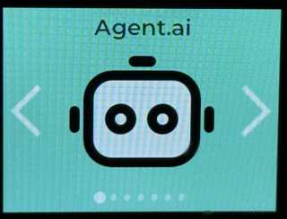
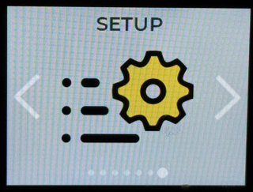
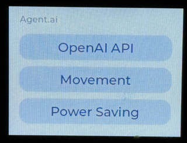

# StackChan-GPT (`GPT-Live` OpenAI Integration)



This repository contains the official [m5stack/StackChan](https://github.com/m5stack/StackChan) firmware modified to use the **OpenAI API** directly when the **`GPT-Live`** (`Agent.ai`) app is selected on the device, without signing into or activating against the original Xiaozhi / M5Stack AI server.

## Quick Flash (`StackChan-GPT-v1.8.11.bin`)

A pre-built merged firmware image for the 16 MB ESP32-S3 board ([`StackChan-GPT-v1.8.11.bin`](StackChan-GPT-v1.8.11.bin)) is included in the repository root:

```bash
esptool.py --chip esp32s3 -p /dev/cu.usbmodem* -b 460800 write_flash 0x0 StackChan-GPT-v1.8.11.bin
```

Before flashing a merged image at `0x0`, make sure your microSD configuration backup is current. The image includes blank gaps over the NVS settings area. The binary contains no API key or Wi-Fi credentials. See [v1.8.9 dance notes](docs/DANCE_v1.8.9.md), [v1.8.7 web search notes](docs/WEB_SEARCH_v1.8.7.md), and [idle camera notes](docs/IDLE_CAMERA_TRACKING_v1.8.7.md).



## Settings persistence (NVS + microSD)

Wi-Fi credentials and OpenAI settings (API key, base URL, models, TTS voice, system prompt, wake word) live in **NVS** on the ESP32 and are mirrored to the microSD card whenever they change (web portal, on-device UI, BLE, or a successful Wi-Fi connect).

| Path | Role |
|------|------|
| NVS (`openai`, Wi-Fi SSID manager) | Primary runtime store |
| `/sdcard/stackchan_config.json` | Full backup (Wi-Fi list + OpenAI fields) |
| `/sdcard/openai_key.txt` or `/sdcard/api_key.txt` | Optional plain-text API key import / mirror |

**Boot sync:** if NVS is empty after a wipe but the SD card has a backup → restore into NVS. If NVS has settings and the card is missing or stale → write NVS → SD. Empty NVS never overwrites a good SD backup.

**Flash modes:**

- **App-only flash** (`idf.py flash` / write starting at the OTA app partition, typically `0x20000`) **keeps NVS** at `0x9000` — settings survive without an SD card.
- **Full merged image at `0x0`** (M5Burner / `esptool write_flash 0x0 StackChan-GPT-v*.bin`) **wipes NVS**. Keep a microSD inserted with a current `stackchan_config.json` so the next boot can restore Wi-Fi and the API key.

Example `stackchan_config.json` schema (do not commit real secrets):

```json
{
  "version": 1,
  "wifi": [{ "ssid": "YourNetwork", "password": "..." }],
  "openai": {
    "api_key": "sk-...",
    "base_url": "https://api.openai.com/v1",
    "chat_model": "gpt-4o-mini",
    "stt_model": "whisper-1",
    "tts_model": "tts-1",
    "tts_voice": "nova",
    "sys_prompt": "...",
    "wake_word": "StackChan"
  }
}
```

## Highlights (`v1.8.11`)

- **Configurable Rest Movement (`SETUP -> Agent.ai -> Movement`)**: Choose how much head movement StackChan performs during rest periods when no chat input or output is active: **None** (no movement), **Little** (brief movement every 5 minutes for $\le$ 10 seconds), **Medium** (brief movement every 3 minutes for $\le$ 20 seconds), or **High** (continuous idle movement).

- **Lower-latency OpenAI voice output**: Non-live models now request OpenAI Speech API audio as raw 24 kHz PCM and stream it directly to the CoreS3 speaker. This removes Ogg demuxing and Opus decoding. GPT-Live continues to use OpenAI's direct speech-to-speech PCM stream.

- **Beat-synced music dance**: Say “dance” / “dance to the music” to call `self.robot.dance`. Mic PCM onset energy estimates BPM (default 120), then the head alternates up/down for 16 beats and right/left for 16, while left/right neon halves flash red → blue → green → purple. Default duration **45 s** (`stop=true` ends early). Listening/thinking LEDs are overridden for the dance. See [docs/DANCE_v1.8.9.md](docs/DANCE_v1.8.9.md).


See [`firmware/README.md`](firmware/README.md) for complete setup, OpenAI API connection methods, build, and flash instructions.

## License

StackChan-GPT original modifications are MIT (`Copyright (c) 2026 StackChan-GPT Contributors`). This project is a modified fork of [M5Stack StackChan](https://github.com/m5stack/StackChan) (MIT, `Copyright (c) 2026 M5Stack Technology CO LTD`). See [LICENSE](LICENSE), third-party attribution in [NOTICE](NOTICE), and website-ready copy in [docs/LICENSE_WEBSITE.md](docs/LICENSE_WEBSITE.md). This firmware is not affiliated with or endorsed by OpenAI; users supply their own API key.
